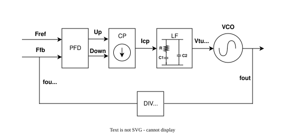
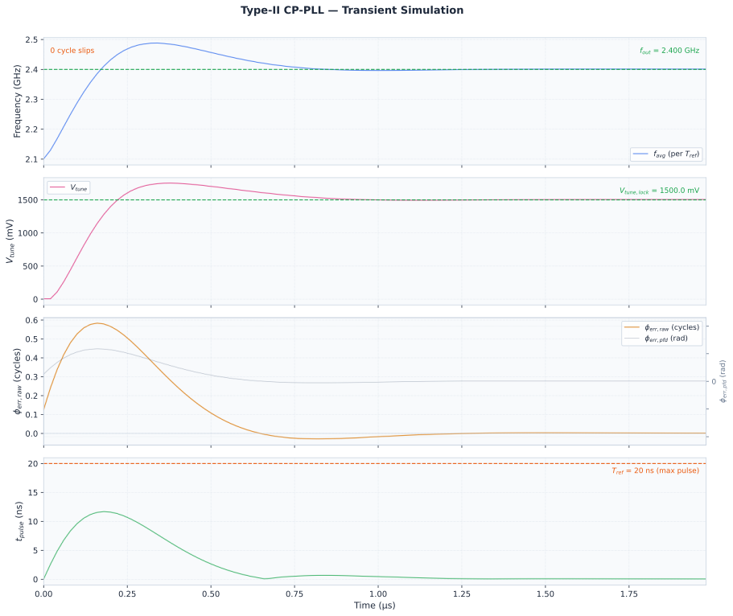
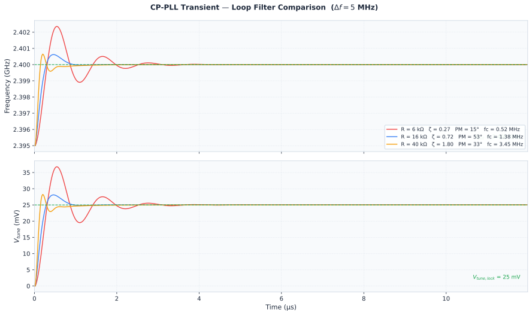

# CP-PLL — Behavioral Transient Model

**Integer-N charge-pump PLL — large-signal transient model for lock acquisition, cycle slip, and settling analysis.**

Mô hình transient large-signal cho Integer-N charge-pump PLL — phân tích lock acquisition, cycle slip, và settling.

---

## What it does

Simulates the PLL **time-domain** behaviour that a linear (Bode / phase-margin) analysis cannot:

- Can the loop lock from a large initial frequency offset $\Delta f = f_{out} - f_{free}$?
- How long does lock take, and how many **cycle slips** happen first?
- How does settling / overshoot change with the loop-filter resistor $R$?

The model is **behavioral** — each block is a math equation, not a transistor netlist — but it captures the large-signal PFD behaviour (±2π range, cycle slips that keep the pump direction) and is cross-checked against an event-driven tri-state PFD (`event_check.py`).

---

## Architecture



| Block | Role | File |
|-------|------|------|
| **PFD + CP** | phase error → charge-pump current pulse (tri-state PFD, linear over ±2π) | `components/pfd.py` |
| **Loop filter** | type-II, R–C1 in parallel with C2 | `components/loop_filter.py` |
| **VCO** | tune voltage → phase | `components/vco.py` |
| **Divider** | ÷N in the feedback path | inline in driver |

### Equations

State vector $\mathbf{y} = [\phi_{vco},\ V_{tune},\ v_{C1}]$.

**PFD + charge pump** — a tri-state PFD is linear over $(-2\pi, +2\pi)$. When the error reaches $\pm 2\pi$ one reference (or divider) edge is lost: the error drops by $2\pi$ but **keeps its sign**, so the CP keeps pumping the same way (this is what makes it a frequency detector). The model carries the phase already dropped, $\phi_{slip}$:

$$
\phi_{err,pfd} = \phi_{err,raw} - \phi_{slip}, \qquad \phi_{slip} \mathrel{+}= 2\pi \ \text{whenever } \phi_{err,pfd} \ge 2\pi
$$

(symmetric for the negative side). `pfd(..., mode='sampled')` instead wraps the error into $(-\pi, \pi]$ and flips the CP polarity at every wrap: a phase detector **without** frequency detection, kept only for comparison. With the default loop it needs 3 slips at Δf = 300 MHz and never locks at 400 MHz, while the PFD locks with no slip.

CP pulse width (clamped to one reference period) and polarity:

$$
t_{pulse} = \min\left(\frac{|\phi_{err,pfd}|}{2\pi f_{ref}},\ T_{ref}\right)
$$

$$
I_{CP} =
\begin{cases}
+I_{CP,up} & \text{if } \phi_{err,pfd} \ge 0 \\
-I_{CP,dn} & \text{if } \phi_{err,pfd} < 0
\end{cases}
$$

**Loop filter** (type-II):

$$
\frac{dV_{tune}}{dt} = \frac{I_{CP} - (V_{tune} - v_{C1})/R}{C_2},
\qquad
\frac{dv_{C1}}{dt} = \frac{V_{tune} - v_{C1}}{R\,C_1}
$$

**VCO** (voltage → frequency → phase):

$$
\frac{d\phi_{vco}}{dt} = 2\pi\left(f_{free} + K_{VCO}\,V_{tune}\right)
$$

---

## Numerical method — hybrid ODE

The charge pump only injects current for $t_{pulse}$ seconds after each reference edge, so every reference period $T_{ref}$ is split into **two phases**, solved sequentially:

- **Phase 1** $[0,\ t_{pulse}]$ — CP on  ($I_{CP} \neq 0$)
- **Phase 2** $[t_{pulse},\ T_{ref}]$ — CP off ($I_{CP} = 0$)

Each phase is integrated with **Radau** (implicit). With the default values $R\,C_2 = 24$ ns and $R\,C_1 = 240$ ns are only 10× apart, so the system is not really stiff: RK45 gives the same result to ~9 digits and runs ~7× faster. Radau stays the safe default for when $C_2$ is made much smaller.

**"VCO-first" ordering:** within each cycle the VCO is advanced first, *then* the reference edge arrives and the phase error / PFD are evaluated — this avoids a spurious 1-cycle jump on the first iteration.

A **cycle slip** is counted each time the detector drops $2\pi$ (i.e. $\phi_{slip}$ changes).

Frequency is read as the **cycle-mean VCO frequency** (phase advance over one $T_{ref}$), not from the $V_{tune}$ sample at the start of the cycle, which carries the CP ripple. "Lock" = that frequency enters and stays within ±2% of the initial Δf.

---

## Files

```
pll/
├── config.py          # parameters + 2nd-order loop-dynamics sanity block (ωn, PM, ζ)
├── solver.py          # sim_one_cycle() — 2-phase-per-cycle hybrid ODE (Radau)
├── pll_sim.py         # main driver — VCO-first loop, cycle-slip detection, lock_time()
├── event_check.py     # cross-check vs event-driven tri-state PFD
├── plot.py            # 4-panel result plot
└── components/
    ├── pfd.py         # PFD + charge pump
    ├── vco.py         # VCO phase rate
    └── loop_filter.py # type-II R-C1 ∥ C2 loop filter ODEs
```

---

## Default parameters (`config.py`)

| Param | Value | | Param | Value |
|---|---|---|---|---|
| `F_REF` | 50 MHz | | `C1` | 15 pF |
| `F_OUT` | 2.4 GHz | | `R` | 16 kΩ |
| `N` | 48 | | `C2` | 1.5 pF |
| `ICP_UP/DN` | 130 µA | | `F_FREE` | 2.1 GHz (Δf = 300 MHz) |
| `KVCO` | 200 MHz/V | | `N_CYCLES` | 100 (= 2 µs) |

Derived (printed by the loop-dynamics block in `config.py`): $\omega_n \approx 6.0$ Mrad/s, **$\zeta \approx 0.72$**, **PM $\approx 52.6°$**.

> With these values the loop locks from Δf = 300 MHz **without** a slip (peak phase error 0.58 cycle). Slips start above Δf ≈ 501 MHz, or at 300 MHz if $I_{CP}$ is lowered to 20 µA (R raised to 40.8 kΩ to keep ζ = 0.72): 3 slips, lock in 2.68 µs.

---

## Run

```bash
pip install numpy scipy matplotlib
cd pll
python pll_sim.py            # tri-state PFD (default)
python pll_sim.py sampled    # ±π detector, for comparison
python event_check.py        # per-cycle model vs event-driven PFD
```

Prints the slip count, lock time and final state, and writes a 4-panel plot to `output/`.

**Example (default config, Δf = 300 MHz):**

```
Cycle slips: 0 at t = [] us
Lock (±2% of df): 0.76 us
Final: f_inst=2.40006 GHz  Vtune=1500.32 mV  (target 1500.0 mV)
```

→ locks in **0.76 µs with no cycle slip**:



`event_check.py` (event-driven vs per-cycle model):

```
df 300 MHz, Icp 130 uA:  event 0 slips, lock 0.78 us  |  per-cycle 0 slips, lock 0.76 us
df 600 MHz, Icp 130 uA:  event 1 slips, lock 0.90 us  |  per-cycle 1 slips, lock 0.88 us
df 300 MHz, Icp 20 uA:  event 3 slips, lock 2.74 us  |  per-cycle 3 slips, lock 2.68 us
```

Sweeping the loop-filter resistor `R` (with a small Δf = 5 MHz) shows how phase margin maps to settling — under-, near-, and over-damped:



---

## Validation

The large-signal model is cross-checked against the small-signal 2nd-order loop:

- $\zeta = \omega_n R C_1 / 2 \approx 0.721$, and $\tan(\mathrm{PM})/2$ from the exact open-loop phase margin agree to within the zero/$C_2$ approximation.
- Lock time, ringing frequency, and settling match the linear prediction once the loop is near lock.

---

## References

Full write-ups (in Vietnamese) on the AMS blog — these articles use this exact model:

- [**CP-PLL transient: when does the PFD slip a cycle?**](https://ams-blog.com/blog/pll-transient-sim-cycle-slip) — builds the behavioral model, finds the slip threshold, compares the PFD with a ±π detector.
- [**CP-PLL Locking Transient — R vs Settling**](https://ams-blog.com/blog/pll-locking-transient) — sweeps `R`, links phase margin ↔ time-domain settling.
- [**PLL Loop Dynamics: Stability & Bandwidth**](https://ams-blog.com/blog/pll-loop-dynamics-stability-bandwidth) — the linear / frequency-domain companion.
